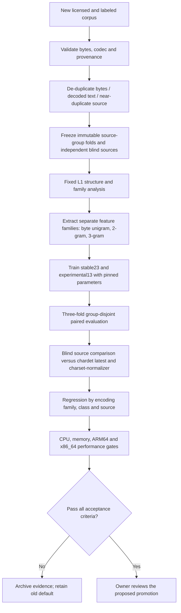

# CodecCat vNext — Annual Retraining Protocol (v1)

**Scope:** Candidate training and evidence generation only. Annual retraining is **not** automatic approval or publication.

## Architecture



## Frozen repeatable procedure

1. Review the license and version of each training source. Verify ground truth labels with Python codecs, record full original byte and decoded-text digests. No external test samples from earlier runs may be promoted into the training set without defining **new, untouched blind source sets** first.
2. Partition by original document / source group **before** any fitting or hyperparameter selection. Prevent same/near-equivalent decoded text leaking between train, development or blind holdout. Fix folds using a stable hash, not Python's process-dependent hash.
3. L1 structural detection is stable, separately regression-tested, and its known solved/unsolved cases are reported. Feature extraction uses raw bytes mapped via Latin-1; train the **separate ordered unigram/bigram/trigram family** in experimental13 against stable23 baseline. Current implementations combine these n-grams in one TF-IDF vectorizer; independent per-family weighting remains a future experiment, **not an implemented fact**.
4. Train both fixed configurations and document any parameter experiments **only using source-group development folds**. Archive feature ranges, vocabulary sizes, full dependency lock, corpus commit, class coverage, dataset fingerprint, numerical model SHA-256 and portable schema. Never infer probabilities from SGD margins.
5. On dev folds report exact labels, identical-decoded-text, top-3 recall, per-family win/loss and per-source regression. Default profile promotion requires source-balanced success across folds and no unexplained large class regressions.
6. Use newly acquired, truly uninspected blind sources for one final confirmation, with current chardet and charset-normalizer on **identical byte prefixes and text-equivalence semantics**. Historical uchardet and UnicodeTestSuite samples are now development diagnostics, not blind confirmation.
7. Measure candidate model inference time, peak RSS, and training memory in free Ubuntu Actions; confirm equivalence on available x86_64/ARM64 hosts without paid runners. If architecture unavailable, mark not passed rather than inventing coverage.
8. If any gate fails, park artifacts without changing `stable23`, `main`, R21, release tags or PyPI. Final promotion requires owner review and an explicit approval decision.

## One-command annual run

GitHub Actions → `vNext annual candidate retrain (no promotion)` → Run workflow → enter cohort year. Or locally (not recommended on the user's Mac):

```bash
PYTHONPATH=src python experiments/logic_first/vnext_annual_retrain.py --year 2026 --training training --training-commit b0c0d206913ba118ffea2f7d306883e7a4a76db7
```

The workflow currently uses a **pinned 2026 baseline corpus**. For 2027 and later, first update and freeze the approved annual sources and their SHAs; merely changing `training_year` does **not** incorporate new data. Review annual results; do not schedule silent auto-promotion. Retain exported GitHub Actions artifacts somewhere durable before their 30-day expiry.

## 2026-10-19 research gate: independent 1/2/3gram weighting

Added `experiments/logic_first/vnext_family_weights.py` and the free Ubuntu workflow `vnext-family-weights.yml`. Weighting is applied to per-ngram-length groups **after fitting the TF-IDF vocabulary, before row renormalization and classifier fitting**, and is reapplied at inference. The comparison must use the actual L1 + L2 `TrainableDetector.rank` path. An early experiment bypassed L1 and was discarded, not used for selection.

[Corrected source-group CV run #39188178613](https://github.com/Johnny-Kao/CodecCat/actions/runs/39188178613), 3,086 rows over frozen three source-disjoint folds:
- Equal weights (1,1,1): **2,833** same decoded text.
- Downweight unigram (0.5,1,1): **2,831**.
- Upweight unigram (1.5,1,1): **2,834** (+1).
- Upweight trigram (1,1,1.5): **2,814**.
- Results by fold should be inspected: slight aggregate improvement can hide regressions. The **+1 / 3,086 is not a meaningful verified win** and does not justify changing model defaults or portable archive format. Do not tune weights based on external corpora.
- Equal-weight score 2,833 agrees with the original 4-way ablation 2,833, but differs from later paired 2,825; discrepancy remains open and may relate to process/runtime non-determinism or dataset/metric implementation rather than weights. Align `PYTHONHASHSEED`, sample order and model fingerprints before accepting a promoted result.
- Next experiment should target *substantially different* features (language-specific decoded-context consistency, byte structural validity) rather than fine-tuning ngram family scalars. A brand-new, unexamined blind source must confirm any subsequent improvements.
