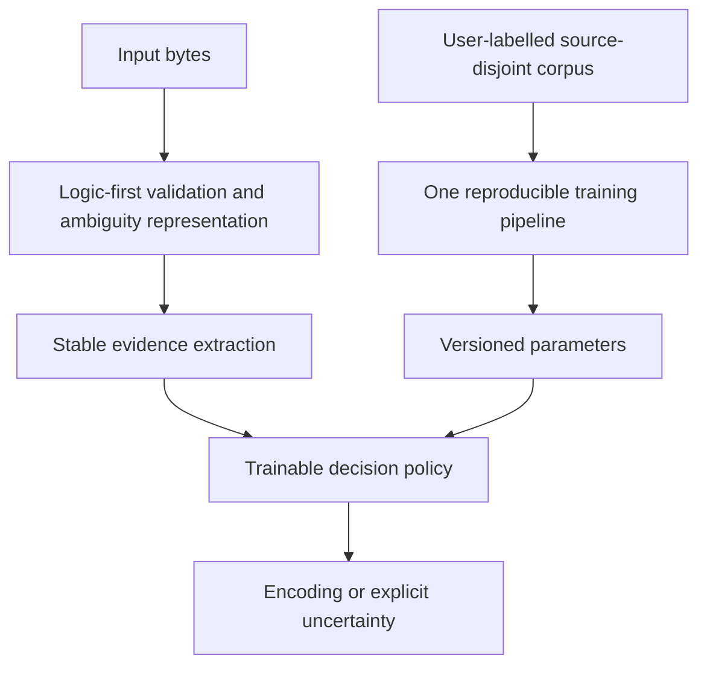

# CodecCat — NEW Logic-First architecture research (authoritative)

## STOP / PARK decision — 2026-10-15

User direction: **PARK ALL PREVIOUS R21/R22/H-series RESEARCH.** Do not optimize, benchmark, rerank, wrap, retrain or adopt R21 as a baseline for the active architecture discovery. Previous Gate 1–3 were aimed at the wrong target; archive their results as historical evidence only. They must not be treated as stages of the new research or used to consume the new project's experiment budget.

No changes to `main`, frozen release assets, or upstream. Do not automatically trigger historical experiment workflows. No more R21-dependent GitHub Actions tests in this research line.

## Actual research question

**Starting from first principles, what encoding detector architecture is most robust, accurate, fast and trainable across independent domains?**

The design sequence is:

### L1 — Structure and invariants FIRST

Decide explicit **valid / invalid / incomplete / ambiguous** semantics. Verify state machines, decoder version compatibility, boundary and truncation rules and multiple encodings accepting identical data. NEVER use invalidity to assert which alternative encoding is true. Document which results are provable, which are statistical. Maintain fast, selective checks, not unconditional all-codec decoding.

### L2 — Evidence representation

Research at least three *independent* evidence families on equal footing, rather than starting from a pre-existing 518-dimensional model:
- Character/byte transition likelihood with directional order, backed by source-distinct corpus statistics.
- Structural grammars and script plausibility; expensive decoding invoked only when needed.
- Multi-scale language-context representation, short-text confidence and rejection/abstention.

Features should have a single stable contract used identically at training and at inference. Profile CPU, peak RSS, model size and short/long-input cost for each design before deciding.

### L3 — Learnable policy and reproducible refresh

User supplies `bytes + encoding + source_group + split`; validate the provenance and refuse exact-byte/source overlap. Run one standardized fit-calibrate-validate-export flow with deterministic seeds. Parameters are fitted; core logic is not rewritten when new annual data arrives. Store schema version, training-data fingerprint, label mapping, estimator configuration, applicability and explicit abstention behavior.

## Research execution rules

1. The NEXT experiment must be a **new-architecture-only** single consolidated GitHub Actions batch, with candidate designs and checks preregistered *before* execution. **No R21 candidate, controls, metrics or legacy model downloads.** Historical research data may inform design pitfalls, but must not be reused as a tuned acceptance set.
2. Measure logic soundness/ambiguity, accuracy on source-separated labelled data, per-label/per-source error, generalization drift, short-text quality, calibration, p50/p95 latency, RSS, training time and model bytes in ONE job.
3. Compare independent architectures, not incremental patches to the same legacy model. Avoid high-cost candidate-by-candidate CI starts. Preserve all raw counts, hashes and per-case traces in one artifact.
4. The previous “5 gates” were scoped incorrectly (three R21-centered experiments); **do not continue counting them as new-architecture proof**. Agree on a fresh bounded research plan in this document and keep its tests to at most two substantive batch runs unless explicitly changed.
5. If necessary data provenance is unavailable, report that constraint clearly; do not manufacture independent validation claims.
6. STOP before release/upstream/main: architecture discovery remains confined to staging/research.

## Repository boundaries

- **PARKED (historical only):** `src/codeccat/runtime.py` R21, `src/codeccat/features.py` HMT768 / 518-D, `src/codeccat/vnext_features.py` (still derived from 518-D), H1–H14 and `experiments/logic_first/gate1_*`, `gate2_*`, `gate3_*`, their older research results/workflows.
- **REUSABLE ONLY IF PROVEN SOUND:** `src/codeccat/logic_first.py` (structural invariants with correct incomplete semantics). Must be independently revalidated.
- **UNVERIFIED INDEPENDENT SKETCH:** `src/codeccat/vnext_independent.py`. It is one possible language model only, NOT the chosen framework. It requires comparative research and should not become the default merely because it was written.
- **NEW ACTIVE WORK:** define fresh data/evidence schema and architecture tournament with no imports from `codeccat.runtime`, `codeccat.features`, legacy R21 model serialization or H-series experiment scripts.

## Success criterion

Choose a *new independent* architecture with a credible **logic correctness gate**, reproducible user-driven fitting, cross-source generalization, and explicitly measured speed/memory costs. Competitive claims require separately verified, non-tuned holdouts. If no candidate is satisfactory, document failure rather than resuming R21 patches.

## New architecture Batch 1 result — completed (2026-10-15)

Run https://github.com/Johnny-Kao/CodecCat/actions/runs/38668067484 (successful, one runner, ~20 seconds job). Code: `experiments/logic_first/new_architecture_batch1.py`. One artifact holds full results and per-sample traces. This is **NEW research batch 1 of at most 2**; prior R21-centred Gate 1–3 remain parked.

**Scope:** 3,117 strictly decodable, byte-deduplicated fixtures from chardet/test-data, grouped by filename stem with three source-disjoint folds, 1 unseen label among heldout instances. No R21 imports, weights, artifacts or comparators.

**Paired architecture ablation** (MultinomialNB with fixed smoothing alpha=0.1; same bytes and splits):
- Byte unigram: 1,529/3,117 = 49.05%.
- Directional adjacent byte transition, 1,024 hash bins: 1,659/3,117 = 53.22%.
- Combined byte unigram + directional transition: 1,713/3,117 = 54.96%.
- alpha=1.0 alternatives each scored lower (47.03%, 50.53%, 52.17% respectively).
- Feature extraction 0.0252 ms/sample; combined model end-to-end ~0.130 ms/sample. Eager five-codec validity evidence ~0.0415 ms/sample; not included in predictor timing or model ranking. A shared-process peak RSS of 229.77 MiB includes sklearn test/training and is **not** an inference-only RSS measure.
- Model selection must account for severe gaps and ambiguity; current performance far below production quality. All results are on a competitor-owned development corpus, not a true independent holdout.

**Gate:** Soundness of byte-level comparisons already needs an explicit fresh proof for the new logic. Training pipeline can fit user-supplied labels, but learned naïve byte frequencies cannot by themselves disambiguate overlapping encodings or reliably generalize. Neither topology nor parameters are accepted for release.

**Required next and final research batch:** test alternative statistical architectures beyond naïve Bayes (e.g. calibrated discriminative models, character script likelihood and truly sequential evidence), short-text abstention/uncertainty, source-disjoint generalization and verified corpus strategy, all predeclared within ONE GitHub Actions job. No R21, H-series or old benchmarks as controls. If a trustworthy independent holdout cannot be found, stop short of any competitive claim.

## Updated research budget — user explicitly allocates FOUR remaining rounds (2026-10-15)

This overrides the earlier "two total new batches" language. One independent new-architecture batch has already finished; FOUR more distinct consolidated research rounds are authorized. **No R21 or H-series imports, model downloads, benchmark controls, or architecture reuse.**

### Round 2 — Full architecture topology tournament (NEXT)
One fixed source-group-disjoint dev corpus; compare at least:
- Separate structural candidate generation and conservative rejection/ambiguity, including a no-veto ablation and incomplete-prefix handling;
- Raw ordered byte n-gram evidence vs decoded-script coherence and their combination;
- Count-based model vs discriminative multinomial logistic/SGD calibrated decisions, with abstention and class imbalance;
- Short 128/1024/4096-byte examples, long inputs, known vs unknown labels, domain strata, confusion clusters;
- Fit cost, end-to-end p50/p95 latency, resource overhead, model parameter sizes, acceptance coverage.

**Primary purpose:** choose a *topology*, not a threshold. Freeze no more than TWO independent architectures for Round 3. A candidate must improve on the independent NB round-1 baseline on source-disjoint data; compare to itself only, never R21.

### Round 3 — Source/domain drift and data sufficiency
Train on separate real-origin sources, test distinct wild/transcoded/suite subpopulations; grouped duplicate-family blocking; learning curves for sample count; confidence stability, insufficient text, UTF/CJK/single-byte balance; no test-file leakage or declaration leakage. Choose ONE architecture and fixed training rules. If data lacks independence, mark uncertainty rather than accept.

### Round 4 — Runtime cost/implementation design
Implement selective C-backed validity, lazy feature extraction, streaming/prefix correctness and schema/bundle reproducibility, no unconditional heavy decode. Test multiple CPU shapes on available free runners in ONE workflow execution, latency distribution, throughput, peak inference-only RSS, bundle size and trainability; freeze implementation. No optimization guided by a future acceptance dataset.

### Round 5 — Independent locked acceptance / final decision
Evaluate frozen implementation and model on separately sourced, audited labels unexposed in rounds 2–4. Include short/long/binary-adjacent and per-language coverage, confidence/abstention and total cost. If no such data or unacceptable metrics, fail explicitly and stop; no post-hoc tuning.

**Execution control:** one job, one runner, one artifact per round; no automatic cross-version CI or parallel hypotheses launched as independent workflows. The existing round-1 sample remains development-only. For each run, record datasets, hashes, seed, split provenance, exact commit and predeclared metrics before running.

## Independent Round 2 sign-off (2026-10-15)

Actions run https://github.com/Johnny-Kao/CodecCat/actions/runs/38668670491; code `experiments/logic_first/new_arch_round2.py`. Successful single job. Total: 3,117 chardet/test-data samples, three grouped folds, 6 predeclared model configurations, 128/1024/4096 byte prefix lengths, with and without strict decode top-five screening. No R21 references.

**4096-byte:** ComplementNB directional hashed 2–3grams 1177/3117 raw, 1544/3117 logic gated (49.53%), SGD 881/3117 raw and 1460/3117 gated (46.84%). Other gated models <=1476/3117. Full running time ~96.84s; single-process peak RSS 420 MiB (training+inference, not production memory). Gate result: no viable winner; worse than Round 1 independent unigram+ordered NB 1713/3117.

**Interpretation:** structural legality *helps* ranking but not enough. Testing several estimators over the same hashed features is insufficient diversity: the next experiment must compare genuinely different feature representation / evidence ordering and train/test provenance, not more SGD/Naive Bayes tweaks. A decoder accepting bytes is not a proof of correct identity. Held-out data is competitor-owned and contains transcoded sibling data; grouped splits mitigate but do not guarantee source independence.

**Research budget:** NEW architecture Rounds 1 and 2 completed, THREE rounds remain (3/4/5). Round 3 must address evidence representation, input provenance, ambiguity and metric calibration in one batch. Do not use historical R21.

## New independent Round 3 sign-off (2026-10-15)

Run https://github.com/Johnny-Kao/CodecCat/actions/runs/38671086756, success; code `experiments/logic_first/new_arch_round3.py`, single GitHub Actions job with artifact. NO R21 imports.
- Dataset: chardet/test-data 3,117 strictly decodable, byte-deduplicated development examples, 3 grouped folds.
- Source-disjoint decoded-script prototype (mean 18-dimensional Unicode script ratios per encoding) and byte 2/3gram MultinomialNB, tested 128/1024/4096 bytes with explicit ambiguity.
- At 4096 bytes: byte statistical 818/3117=26.24%; decoded-language 594/3117=19.06%; combined 764/3117=24.51%; logic-only unique-candidate classification 0/3117. All 3,117 had multiple decoder-acceptable candidates; the true label was a viable candidate for 3,116/3,117 (the one discrepancy may reflect prefix/alias/truncation handling and needs triage). This is **not** an acceptable accuracy result.
- Combined score employed a preregistered fixed multiplier, not calibrated source-generalizing model. Therefore cannot infer that all hybrid architectures are poor. Byte statistical baseline differs from Round 1/2 and must not be described as controlled architecture-versus-architecture regression.
- Eager five-codec decoder diagnostic ~40.2 microseconds/sample; process max RSS 475 MiB includes Python/scikit training and traces, not inference-only memory.
- Research finding: validity evidence rarely uniquely identifies real-world encoding; language evidence must be discriminative and source-aware, rather than coarse script totals. The next round must avoid re-running the same competitor-owned corpus as a surrogate for generalization.

Budget now: independent rounds 1,2,3 completed. **Two rounds remain** under current user instruction; save one for final locked acceptance. Stop changing weights without new provenance. Core Logic-First structural state contract remains valid as design goal but no complete detector is accepted.
