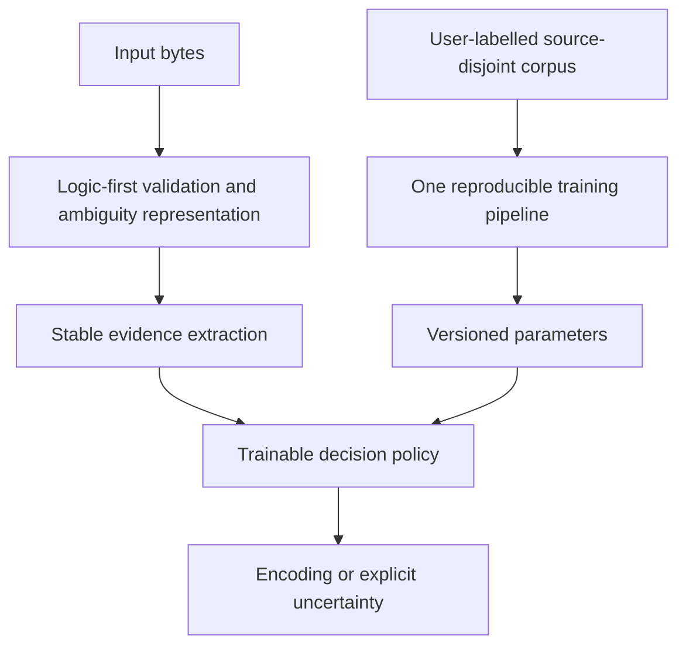

# CodecCat — NEW Logic-First architecture research (authoritative)

## STOP / PARK decision — 2026-10-15

User direction: **PARK ALL PREVIOUS R21/R22/H-series RESEARCH.** Do not optimize, benchmark, rerank, wrap, retrain or adopt R21 as a baseline for the active architecture discovery. Previous Gate 1–3 were aimed at the wrong target; archive their results as historical evidence only. They must not be treated as stages of the new research or used to consume the new project's experiment budget.

No changes to `main`, frozen release assets, or upstream. Do not automatically trigger historical experiment workflows. No more R21-dependent GitHub Actions tests in this research line.

## Actual research question

**Starting from first principles, what encoding detector architecture is most robust, accurate, fast and trainable across independent domains?**

The design sequence is:

### L1 — Structure and invariants FIRST

Decide explicit **valid / invalid / incomplete / ambiguous** semantics. Verify state machines, decoder version compatibility, boundary and truncation rules and multiple encodings accepting identical data. NEVER use invalidity to assert which alternative encoding is true. Document which results are provable, which are statistical. Maintain fast, selective checks, not unconditional all-codec decoding.

### L2 — Evidence representation

Research at least three *independent* evidence families on equal footing, rather than starting from a pre-existing 518-dimensional model:
- Character/byte transition likelihood with directional order, backed by source-distinct corpus statistics.
- Structural grammars and script plausibility; expensive decoding invoked only when needed.
- Multi-scale language-context representation, short-text confidence and rejection/abstention.

Features should have a single stable contract used identically at training and at inference. Profile CPU, peak RSS, model size and short/long-input cost for each design before deciding.

### L3 — Learnable policy and reproducible refresh

User supplies `bytes + encoding + source_group + split`; validate the provenance and refuse exact-byte/source overlap. Run one standardized fit-calibrate-validate-export flow with deterministic seeds. Parameters are fitted; core logic is not rewritten when new annual data arrives. Store schema version, training-data fingerprint, label mapping, estimator configuration, applicability and explicit abstention behavior.

## Research execution rules

1. The NEXT experiment must be a **new-architecture-only** single consolidated GitHub Actions batch, with candidate designs and checks preregistered *before* execution. **No R21 candidate, controls, metrics or legacy model downloads.** Historical research data may inform design pitfalls, but must not be reused as a tuned acceptance set.
2. Measure logic soundness/ambiguity, accuracy on source-separated labelled data, per-label/per-source error, generalization drift, short-text quality, calibration, p50/p95 latency, RSS, training time and model bytes in ONE job.
3. Compare independent architectures, not incremental patches to the same legacy model. Avoid high-cost candidate-by-candidate CI starts. Preserve all raw counts, hashes and per-case traces in one artifact.
4. The previous “5 gates” were scoped incorrectly (three R21-centered experiments); **do not continue counting them as new-architecture proof**. Agree on a fresh bounded research plan in this document and keep its tests to at most two substantive batch runs unless explicitly changed.
5. If necessary data provenance is unavailable, report that constraint clearly; do not manufacture independent validation claims.
6. STOP before release/upstream/main: architecture discovery remains confined to staging/research.

## Repository boundaries

- **PARKED (historical only):** `src/codeccat/runtime.py` R21, `src/codeccat/features.py` HMT768 / 518-D, `src/codeccat/vnext_features.py` (still derived from 518-D), H1–H14 and `experiments/logic_first/gate1_*`, `gate2_*`, `gate3_*`, their older research results/workflows.
- **REUSABLE ONLY IF PROVEN SOUND:** `src/codeccat/logic_first.py` (structural invariants with correct incomplete semantics). Must be independently revalidated.
- **UNVERIFIED INDEPENDENT SKETCH:** `src/codeccat/vnext_independent.py`. It is one possible language model only, NOT the chosen framework. It requires comparative research and should not become the default merely because it was written.
- **NEW ACTIVE WORK:** define fresh data/evidence schema and architecture tournament with no imports from `codeccat.runtime`, `codeccat.features`, legacy R21 model serialization or H-series experiment scripts.

## Success criterion

Choose a *new independent* architecture with a credible **logic correctness gate**, reproducible user-driven fitting, cross-source generalization, and explicitly measured speed/memory costs. Competitive claims require separately verified, non-tuned holdouts. If no candidate is satisfactory, document failure rather than resuming R21 patches.

## New architecture Batch 1 result — completed (2026-10-15)

Run https://github.com/Johnny-Kao/CodecCat/actions/runs/38668067484 (successful, one runner, ~20 seconds job). Code: `experiments/logic_first/new_architecture_batch1.py`. One artifact holds full results and per-sample traces. This is **NEW research batch 1 of at most 2**; prior R21-centred Gate 1–3 remain parked.

**Scope:** 3,117 strictly decodable, byte-deduplicated fixtures from chardet/test-data, grouped by filename stem with three source-disjoint folds, 1 unseen label among heldout instances. No R21 imports, weights, artifacts or comparators.

**Paired architecture ablation** (MultinomialNB with fixed smoothing alpha=0.1; same bytes and splits):
- Byte unigram: 1,529/3,117 = 49.05%.
- Directional adjacent byte transition, 1,024 hash bins: 1,659/3,117 = 53.22%.
- Combined byte unigram + directional transition: 1,713/3,117 = 54.96%.
- alpha=1.0 alternatives each scored lower (47.03%, 50.53%, 52.17% respectively).
- Feature extraction 0.0252 ms/sample; combined model end-to-end ~0.130 ms/sample. Eager five-codec validity evidence ~0.0415 ms/sample; not included in predictor timing or model ranking. A shared-process peak RSS of 229.77 MiB includes sklearn test/training and is **not** an inference-only RSS measure.
- Model selection must account for severe gaps and ambiguity; current performance far below production quality. All results are on a competitor-owned development corpus, not a true independent holdout.

**Gate:** Soundness of byte-level comparisons already needs an explicit fresh proof for the new logic. Training pipeline can fit user-supplied labels, but learned naïve byte frequencies cannot by themselves disambiguate overlapping encodings or reliably generalize. Neither topology nor parameters are accepted for release.

**Required next and final research batch:** test alternative statistical architectures beyond naïve Bayes (e.g. calibrated discriminative models, character script likelihood and truly sequential evidence), short-text abstention/uncertainty, source-disjoint generalization and verified corpus strategy, all predeclared within ONE GitHub Actions job. No R21, H-series or old benchmarks as controls. If a trustworthy independent holdout cannot be found, stop short of any competitive claim.

## Updated research budget — user explicitly allocates FOUR remaining rounds (2026-10-15)

This overrides the earlier "two total new batches" language. One independent new-architecture batch has already finished; FOUR more distinct consolidated research rounds are authorized. **No R21 or H-series imports, model downloads, benchmark controls, or architecture reuse.**

### Round 2 — Full architecture topology tournament (NEXT)
One fixed source-group-disjoint dev corpus; compare at least:
- Separate structural candidate generation and conservative rejection/ambiguity, including a no-veto ablation and incomplete-prefix handling;
- Raw ordered byte n-gram evidence vs decoded-script coherence and their combination;
- Count-based model vs discriminative multinomial logistic/SGD calibrated decisions, with abstention and class imbalance;
- Short 128/1024/4096-byte examples, long inputs, known vs unknown labels, domain strata, confusion clusters;
- Fit cost, end-to-end p50/p95 latency, resource overhead, model parameter sizes, acceptance coverage.

**Primary purpose:** choose a *topology*, not a threshold. Freeze no more than TWO independent architectures for Round 3. A candidate must improve on the independent NB round-1 baseline on source-disjoint data; compare to itself only, never R21.

### Round 3 — Source/domain drift and data sufficiency
Train on separate real-origin sources, test distinct wild/transcoded/suite subpopulations; grouped duplicate-family blocking; learning curves for sample count; confidence stability, insufficient text, UTF/CJK/single-byte balance; no test-file leakage or declaration leakage. Choose ONE architecture and fixed training rules. If data lacks independence, mark uncertainty rather than accept.

### Round 4 — Runtime cost/implementation design
Implement selective C-backed validity, lazy feature extraction, streaming/prefix correctness and schema/bundle reproducibility, no unconditional heavy decode. Test multiple CPU shapes on available free runners in ONE workflow execution, latency distribution, throughput, peak inference-only RSS, bundle size and trainability; freeze implementation. No optimization guided by a future acceptance dataset.

### Round 5 — Independent locked acceptance / final decision
Evaluate frozen implementation and model on separately sourced, audited labels unexposed in rounds 2–4. Include short/long/binary-adjacent and per-language coverage, confidence/abstention and total cost. If no such data or unacceptable metrics, fail explicitly and stop; no post-hoc tuning.

**Execution control:** one job, one runner, one artifact per round; no automatic cross-version CI or parallel hypotheses launched as independent workflows. The existing round-1 sample remains development-only. For each run, record datasets, hashes, seed, split provenance, exact commit and predeclared metrics before running.

## Independent Round 2 sign-off (2026-10-15)

Actions run https://github.com/Johnny-Kao/CodecCat/actions/runs/38668670491; code `experiments/logic_first/new_arch_round2.py`. Successful single job. Total: 3,117 chardet/test-data samples, three grouped folds, 6 predeclared model configurations, 128/1024/4096 byte prefix lengths, with and without strict decode top-five screening. No R21 references.

**4096-byte:** ComplementNB directional hashed 2–3grams 1177/3117 raw, 1544/3117 logic gated (49.53%), SGD 881/3117 raw and 1460/3117 gated (46.84%). Other gated models <=1476/3117. Full running time ~96.84s; single-process peak RSS 420 MiB (training+inference, not production memory). Gate result: no viable winner; worse than Round 1 independent unigram+ordered NB 1713/3117.

**Interpretation:** structural legality *helps* ranking but not enough. Testing several estimators over the same hashed features is insufficient diversity: the next experiment must compare genuinely different feature representation / evidence ordering and train/test provenance, not more SGD/Naive Bayes tweaks. A decoder accepting bytes is not a proof of correct identity. Held-out data is competitor-owned and contains transcoded sibling data; grouped splits mitigate but do not guarantee source independence.

**Research budget:** NEW architecture Rounds 1 and 2 completed, THREE rounds remain (3/4/5). Round 3 must address evidence representation, input provenance, ambiguity and metric calibration in one batch. Do not use historical R21.

## New independent Round 3 sign-off (2026-10-15)

Run https://github.com/Johnny-Kao/CodecCat/actions/runs/38671086756, success; code `experiments/logic_first/new_arch_round3.py`, single GitHub Actions job with artifact. NO R21 imports.
- Dataset: chardet/test-data 3,117 strictly decodable, byte-deduplicated development examples, 3 grouped folds.
- Source-disjoint decoded-script prototype (mean 18-dimensional Unicode script ratios per encoding) and byte 2/3gram MultinomialNB, tested 128/1024/4096 bytes with explicit ambiguity.
- At 4096 bytes: byte statistical 818/3117=26.24%; decoded-language 594/3117=19.06%; combined 764/3117=24.51%; logic-only unique-candidate classification 0/3117. All 3,117 had multiple decoder-acceptable candidates; the true label was a viable candidate for 3,116/3,117 (the one discrepancy may reflect prefix/alias/truncation handling and needs triage). This is **not** an acceptable accuracy result.
- Combined score employed a preregistered fixed multiplier, not calibrated source-generalizing model. Therefore cannot infer that all hybrid architectures are poor. Byte statistical baseline differs from Round 1/2 and must not be described as controlled architecture-versus-architecture regression.
- Eager five-codec decoder diagnostic ~40.2 microseconds/sample; process max RSS 475 MiB includes Python/scikit training and traces, not inference-only memory.
- Research finding: validity evidence rarely uniquely identifies real-world encoding; language evidence must be discriminative and source-aware, rather than coarse script totals. The next round must avoid re-running the same competitor-owned corpus as a surrogate for generalization.

Budget now: independent rounds 1,2,3 completed. **Two rounds remain** under current user instruction; save one for final locked acceptance. Stop changing weights without new provenance. Core Logic-First structural state contract remains valid as design goal but no complete detector is accepted.

## Independent Round 4 sign-off — full layered ablation (2026-10-15)

Run: https://github.com/Johnny-Kao/CodecCat/actions/runs/38673401495 — GitHub Action SUCCESS for execution; **architecture FAIL**. Test code `experiments/logic_first/new_arch_round4.py`, one runner, single grouped development corpus, no R21.

On 3,117 development fixtures, 4-KB paired model scores:
- L2-only 714/3117 = 22.91%.
- L1→L2 962/3117 = 30.86%.
- L2→L3 853/3117 = 27.37%.
- L1→L2→L3 962/3117 = 30.86%.
- Initial gate: 345 helps, 97 harms, 153 cases where true label excluded from surviving supported candidates. **NOT sound enough** for hard rejection. Some exclusions could reflect raw-label alias/BOM or boundary choices; cannot assert all are true invalidity until investigated.
- L3: invoked for 3,116 of 3,117 cases at 4 KB, with **zero changes to outcome** after L1. Redundant structural verification: it should be removed/replaced, not optimized.
- Eager L1 scans candidate codecs; median L1-only 0.492 ms/sample at 4 KB. This is **not** total pipeline latency. Test mixed-process peak RSS 415.34 MiB, not inference-only RSS.
- Test corpus remains competitor-owned chardet/test-data and model statistical features are intentionally simple, so no competitive detection claim. The numeric comparison across independent rounds is not controlled due to changed estimators and features.

**Decision:** Keep only the three-layer interface as research hypothesis. Reject current hard L1, current almost-always L3 and current L2 classifier as production implementations. One remaining authorized new-architecture research round; it must focus on *correcting false exclusions and demonstrating informative conditional L3*, with independent label provenance and holistic cost. No auto-promotion to release, even if CI green.

## Strong L2 comparative result and negative L3 evidence (2026-10-15)

[GitHub Actions #38678823019](https://github.com/Johnny-Kao/CodecCat/actions/runs/38678823019), success. This was a further development experiment after the original four research rounds, NOT an independent final sign-off. All 3,117 samples originated in chardet/test-data; 3-fold filename-derived grouped splits, 7 labels unseen in training for one fold. No R21 code or model used. Report artifact `vnext-strong-l2-development`.

| New L2 evidence/policy | Direct L2 | After L1 | After existing L3 |
|---|---:|---:|---:|
| Count byte 1–2gram + ComplementNB | 1,564 | 2,137 | 2,102 |
| TF-IDF ordered 2–3gram + LinearSVC | 2,213 | 2,410 | 2,384 |
| TF-IDF ordered 2–3gram + SGD modified_huber | 2,346 | **2,493** | 2,458 |

Counts are out of 3,117. 2,493/3,117 = 79.98%, **development-only**. The last model's L3 caused 39 harms vs 4 corrections (negative 35), so existing control-character-based L3 has been **disabled by default** in `src/codeccat/vnext_pipeline.py`. The L1 viability accounting excluded 7 true labels, which are also unseen training labels; do not call these seven proven decoder invalidities. Peak mixed Python research-process RSS was 478.82 MiB and includes training, not inference-only memory.

**Architecture implication:** L2 requires directional contextual evidence and a trained discriminative decision function rather than the initial unigram + simplistic model. The current `vnext_pipeline.Model` still trains a small native byte-transition model; this test does **not** mean the stronger sklearn model has been installed in the runtime. Next engineering task is to implement an independent `strong_l2` adapter + one versioned bundled model with deterministic feature schema, validate it source-disjoint, then measure isolated inference p50/p95/RSS and external corpus transfer. L3 should stay disabled until a selective NEW evidence mechanism demonstrates positive corrections minus harms.

## Actual L2 deployment measurement + performance repairs (2026-10-15)

**Development diagnostic, not independent production acceptance.**

- [Run 38681319244](https://github.com/Johnny-Kao/CodecCat/actions/runs/38681319244): actual `TrainableDetector`, 3 source-stem-disjoint folds, 3,086 samples, 2,175 correct = **70.48%**, median 7.5137 ms, p95 9.3113 ms. P50/p95 measured per sample within same process; training cost and memory not isolated.
- [Run 38681562623](https://github.com/Johnny-Kao/CodecCat/actions/runs/38681562623): lazy top-three structural candidate checking, same 2,175/3,086, p50 7.1711 ms, p95 8.9935 ms. **Note**: API `candidates` now means at most three *validated* ranked candidates, not the full feasible encoding universe. `truth_retained` from before/after lazy mode is NOT a paired comparable safety metric.
- [Run 38681762500](https://github.com/Johnny-Kao/CodecCat/actions/runs/38681762500): phase profile, 320 cases: BOM median 1.34 microseconds, Latin-1 preparation 0.9 μs, sklearn TF-IDF feature transform 1,816 μs, SGD `decision_function` 2,878 μs, codec scan of five 26.5 μs. Therefore don't waste work on more eager codec heuristics: accelerate the linear model / feature transform while preserving the exact feature schema.
- First sparse weight-direct scoring change accidentally treated the multiclass score vector as a binary signed decision margin, causing a diagnostic failure 196/3086 (6.35%). This was a **CODE BUG**, not model performance, and **not eligible for publication or architectural conclusions**. Fixed by branching on actual `len(classes)==2`, with explicit multiclass consistency test.
- [Run 38681972531](https://github.com/Johnny-Kao/CodecCat/actions/runs/38681972531): **corrected sparse direct scoring**, same actual 2,175/3,086 **70.48%**; P50 **3.0613 ms**, P95 **4.5101 ms**. Against original actual module, median inference now approximately 2.45× faster; p95 about 2.06× faster. Scores are still below accuracy target and speed target. Joblib model loading is trusted-files-only.
- Remaining work: statistically independent verified-labelled source, user-trainable source-disjoint pipeline with immutable schema, confidence calibration and abstention measurement; optimize feature extraction bottleneck (roughly 1.8 ms/sample before recent linear-scoring change) while preserving rank, and report inference-only RSS. `main`, R21 and release are unchanged.

**Research/process correction:** the current `vnext_actual_adapter.py` benchmark uses *effective 4-KB bytes* for duplicate blocking; prior research scripts used full payload SHA and then truncated for features. Numeric comparisons between those corpora are *not paired* and must not be conflated. Model classes absent in a training fold are scored as out-of-coverage, not as prediction mistakes caused by L1.

## Paired competitor comparison and BOM label normalization (2026-10-15)

Independent implementation audited on the same *competitor-owned* chardet/test-data corpus; no release claim.

- [Run 38682597433](https://github.com/Johnny-Kao/CodecCat/actions/runs/38682597433), 3,003 effective-prefix deduplicated examples, source-stem grouped, exact Python codec name accuracy. Initial: CodecCat 2,103/3,003 **70.03%**, chardet 1,668/3,003 **55.54%**, charset-normalizer 2,179/3,003 **72.56%**.
- Per-label error attribution: **219/219 generic `utf-16` and 154/154 generic `utf-32`** were emitted as explicit `-le/-be` codepage labels and counted wrong. This was a *policy/label normalization defect*, not a language modeling defect.
- Corrected the BOM fast path: if a trained generic `utf-16` / `utf-32` label exists, prefer that for BOM-bearing streams, without changing the policy for `utf-8-sig`. Regression tests added and passing.
- [Run 38682966352](https://github.com/Johnny-Kao/CodecCat/actions/runs/38682966352), SAME 3,003 rows: CodecCat **2,476/3,003 = 82.45%**, chardet **55.54%**, charset-normalizer **72.56%**. Paired wins/losses vs charset-normalizer: 583 ours-only correct, 286 theirs-only correct; vs chardet 967 ours-only correct, 159 theirs-only correct.
- **Important limitations:** This is not an independent holdout (source repository belongs to chardet), the data sample and exact-label metric include encoding-equivalence ambiguities, and competitor versions fixed to chardet 5.2.0 / charset-normalizer 3.4.4. No end-to-end production sign-off.
- Hardest remaining families: `iso8859-1` (39 errors/74), `cp1252` (34/42), `iso8859-15` (34/41), `cp850` (26/45), `cp437` (24/33), `cp858` (24/32), `cp500` (23/25). Many overlaps are byte-level inherently ambiguous; improve outcome by measuring equivalence-aware decoding accuracy, collecting disjoint modern text, selectively verifying **language plausibility**, and abstaining when unidentifiable. Do not add blanket rules to force inherently ambiguous labels.

This is a concrete accuracy gain from proper contract semantics, not increased trained language model discrimination.

## Accuracy-first byte-identifiability audit and UTF-16 repair (2026-10-15)

- [Equivalence diagnostic run #38683411004](https://github.com/Johnny-Kao/CodecCat/actions/runs/38683411004), 3,003 development fixture samples grouped by source stem: **2,476 (82.45%) exact encoding label**, **2,674 (89.04%) same decoded text**, **198 label mismatch with identical decoded text**, **329 actual different-text failures**. The 198 cases are intrinsically label-ambiguous from their bytes; never count these as text corruption and never claim their exact historical label is inferable.
- Major meaningful errors within 329: 33 UTF-16-BE, 19 UTF-16-LE, 22 CP500, 18 ISO-8859-15, 18 CP1252, 16 ISO-8859-1, 14 CP1250, 13 HP-ROMAN8, 12 UTF-8, 11 ISO-8859-16, etc.
- L1/L2 boundary repair: added narrowly guarded BOM-less UTF-16 endian inference only for ASCII-heavy data with strong zero-byte parity (>=12 or 30% of pairs, >=4x opposite parity), and only when exact trained endian label has strict-decode viability. Other samples fall back to trainable L2; avoids broad hard-coded word lists.
- [Paired run #38683570487](https://github.com/Johnny-Kao/CodecCat/actions/runs/38683570487), SAME 3,003 fixtures and metric: **2,526/3,003 = 84.12%** exact-label vs **2,476/3,003 = 82.45%** before; gain **+50 correct predictions**. chardet 55.54%, charset-normalizer 72.56% unchanged. This is still competitor-owned development corpus, not independent acceptance. Structural tests [#38683599634](https://github.com/Johnny-Kao/CodecCat/actions/runs/38683599634) pass.
- Critical remaining work is accurate decoded-language evidence for near-identical single-byte codepages and independent corpus acceptance. Avoid forcing arbitrary historical encoding labels on byte streams that produce identical decoded text.

## Residual training after L1 (2026-10-15, accuracy-first)

User-approved principle: encode deterministic byte/grammar evidence separately from trainable language evidence, do not keep teaching L2 easy patterns that L1 already resolves. Implemented source-group-fold paired ablations at `experiments/logic_first/vnext_residual_study.py`, no R21.

**Same 3,086 development holdout samples, 3 group-held-out folds, same feature/model/parameters:**

| Training strategy | Cumulative 3-fold train examples | Correct out of 3,086 | Accuracy |
|---|---:|---:|---:|
| All train rows | 6,172 | 2,598 | 84.187% |
| Aggressive removal of all L1-correct, >=2 per class retained | 4,720 (-23.5%) | 2,594 | 84.057% |
| **Conservative removal capped to 35% of each label**, >=2 per class | **5,598 (-9.3%)** | **2,611** | **84.608%** |

Evidence: [aggressive run #38687344481](https://github.com/Johnny-Kao/CodecCat/actions/runs/38687344481) and [capped run #38687567824](https://github.com/Johnny-Kao/CodecCat/actions/runs/38687567824). Capped residual training gained 76 previously wrong predictions and harmed 63 previously correct ones: **net +13**. Per-fold deltas **+16, +3, -6**, so non-uniform and not independent confirmation. No hyperparameter change; measured effect comes from the *choice of training examples*. Group-separation asserts no stem overlap across train and test. The corpus remains competitor-owned and is not an independent acceptance sample.

**Engineering decision:** treat L1-resolved sample exclusion as **weighted/limited data selection**, not unlimited pruning. Prefer retaining enough samples per encoding, variation of source groups and edge conditions. Never eliminate an encoding class just because its most obvious examples are structurally identifiable. The current prototype uses max removal 35% per label; this is **a tuned development candidate** and must not be shipped as a generalized default until separately held-out cross-domain results prove gains. Trainable L2 should focus on residual ambiguous strings; structural L1 should not train its byte grammar on shifting language distributions.

The latest 84.608% is not directly comparable to prior 84.116% audit as the dataset is 3,086 vs 3,003 effective prefix-deduplicated samples and independent evaluation policy differs.

## Paired easy-sample weighting versus capped removal (2026-10-15)

[GitHub Actions 38689808845](https://github.com/Johnny-Kao/CodecCat/actions/runs/38689808845) compares four policies on exactly the same 3,086 source-group-held-out development examples, with the same TF-IDF 2/3-gram + SGD model and train/test grouping. Trained examples L1 could correctly solve were either capped-removed or assigned reduced SGD `sample_weight`.

| Policy | Correct / 3,086 | Accuracy | By-fold correct |
|---|---:|---:|---|
| Full-weight all samples | 2,598 | 84.187% | 971 / 705 / 922 |
| Capped removal (max 35% per label) | **2,611** | **84.608%** | 987 / 708 / 916 |
| Retain all, L1-easy weight 0.35 | 2,610 | 84.576% | 973 / 710 / 927 |
| Retain all, L1-easy weight 0.65 | 2,598 | 84.187% | 973 / 710 / 915 |

0.35 weighting vs capped removal: **68 helps / 69 harms**, net -1. 0.65 weight vs capped removal: 50 helps / 63 harms, net -13. Neither weighted candidate exceeds capped pruning. Because per-fold patterns differ, **do not promote fixed weight or pruning parameter as a generally optimal setting**. Better next study: partition paired disagreements by label, language/source group and identifiability; collect truly independent corpora before further tuning.

The key transferable design is to avoid repeatedly training L2 on samples already resolved by stable L1 structural evidence while retaining class diversity and enough hard-negative examples. Do not let L1's byte pattern shortcut become a hard-coded language prior. R21/main/release unchanged.

## External-source acceptance diagnostic (2026-10-15)

First train/holdout **different repository** comparison completed successfully at [GitHub Actions #38690966822](https://github.com/Johnny-Kao/CodecCat/actions/runs/38690966822). The source test set is pinned `TypesettingTools/uchardet` SHA `6789ebf11be838019c6b0ed979ab87e6dac5e1f8`, while training only uses `chardet/test-data` SHA `b0c0d206913ba118ffea2f7d306883e7a4a76db7`. Evaluator: `experiments/logic_first/vnext_external_holdout.py`; artifacts contain full per-example trace and report.

**Critical source leakage control:** 113 labeled samples discovered, of which 33 have exact training-byte overlap and 36 have training decoded-text overlap. Only the **77 samples with neither exact bytes nor exact decoded text overlap** are the primary external diagnostic. Independent repo origin does *not* guarantee unique text; removing overlap is necessary.

| Model | External nonoverlap exact label | External nonoverlap identical decoded text |
|---|---:|---:|
| CodecCat vNext | **49/77 = 63.64%** | **56/77 = 72.73%** |
| charset-normalizer 3.4.4 | 46/77 = 59.74% | 55/77 = 71.43% |
| chardet 5.2.0 | 34/77 = 44.16% | 34/77 = 44.16% |

All 113, including overlaps: CodecCat 82 exact / 89 text; charset-normalizer 64 exact / 85 text; chardet 55 exact / 57 text.

**Do not claim signoff or broad superiority.** The nonoverlap corpus has only 77 samples from many labels with a singleton; 3-sample exact advantage and 1-sample decoded-text advantage are fragile. Data provenance is different, but close textual similarity beyond *exact* decoded SHA was not excluded. This is evidence the approach is viable across a limited external source, but training/source diversity and especially rare encoding coverage are critical next priorities. Avoid hyperparameter training on this protected external diagnostic: doing so would turn it into a development set.

This experiment used the capped L1-resolved residual training policy and unchanged UTF structure gates; no R21/main/release modification.
